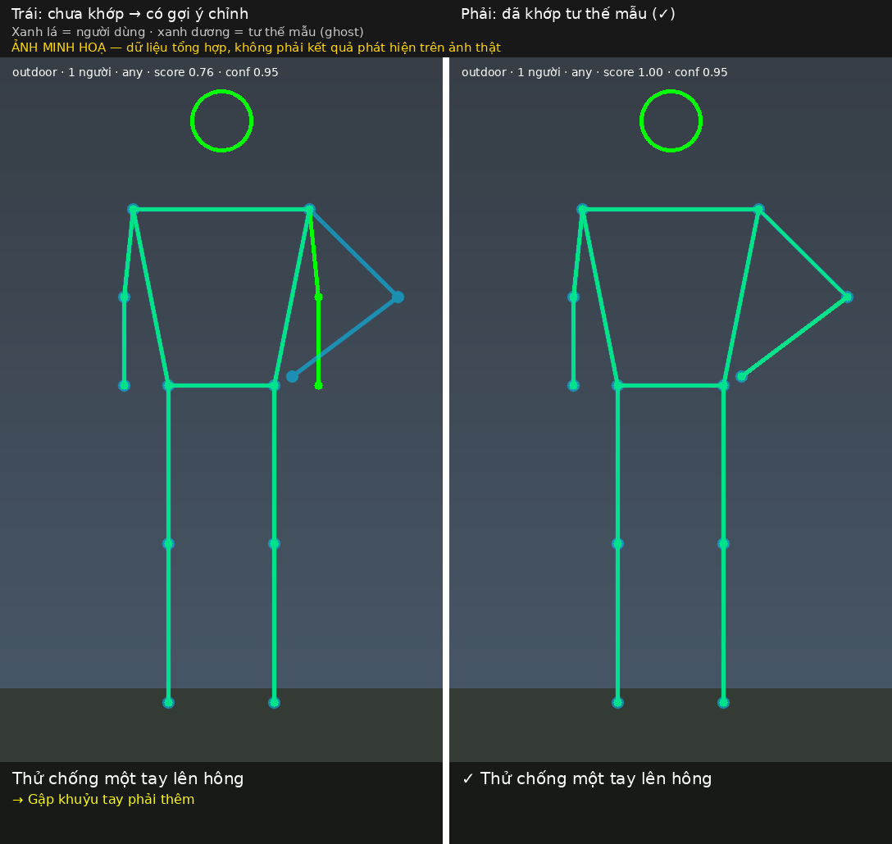
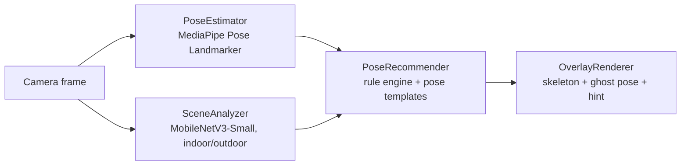

# Pose Suggestion Camera Assistant

An on-device camera feature that suggests photo poses for the current scene and shows them as a
ghost-skeleton overlay on the camera preview, inspired by AI pose-guide features on phone cameras.

> **Status: proof of concept.** Pretrained models plus a hand-written rule engine. No model is trained
> for pose recommendation, and on-device latency has **not been measured yet** (see [Status](#status)).

## Demo

<p align="center">
  
</p>

*Left: the user's pose does not match the template, so the app shows the template as a blue ghost skeleton and a
computed hint ("bend the right elbow more"). Right: the pose matches, so the hint disappears and a check mark is shown.*

> **This image is a rendering preview built from synthetic keypoints** (`scripts/make_demo_preview.py`), using the
> same drawing and recommendation code as the pipeline. It is **not** output on a real photo. Real-photo results
> will be added after the MPII template library is built (see Status). Scores in the image come from the code,
> but on a toy example.

## How it works



The four stages sit behind small interfaces so the rule engine can later be swapped for retrieval-
or LLM-based recommendation without rewriting the rest.

**PoseRecommender (v2, `src/05_upgrade_v2.py`)**
- Keypoints are converted to pixels, then normalised (origin = pelvis, unit = torso length), so the
  match does not depend on image size or aspect ratio.
- Score = joint-position similarity + joint-angle similarity (elbows, knees, arm raise, shoulder tilt,
  torso lean); the mirrored pose is also tried.
- The correction hint is computed from the largest angle difference (e.g. "bend the right elbow more").
- Landmarks are smoothed with a One-Euro filter; a hysteresis selector stops the suggestion flickering.

## Results so far

| Component | Setup | Result |
|---|---|---|
| Pose detection | MediaPipe Pose Landmarker (lite), 200 sampled single-person COCO val2017 images | Person detected in 159/200 images (79.5%) |
| Pose accuracy | Same run, **only images where a person was detected** | PCK@0.5×torso = 0.842 (not the standard PCKh) |
| Scene classifier | MobileNetV3-Small, ImageNet backbone frozen, 2-class head trained on a Places365 val split | Test accuracy 0.905 vs 0.562 majority-class baseline |
| Recommender quality | — | Not measured: no ground-truth labels yet |
| On-device latency | — | **Not measured yet** |

Caveats: the scene classifier is trained and tested on a random split of the same Places365 val set,
so it says little about real camera frames. PCK excludes the 41 images where nothing was detected.

## Status

- [x] Pose benchmark, scene classifier, rule-based recommender
- [x] Ghost-skeleton overlay, smoothing, computed hints, per-stage latency meter (desktop)
- [x] Core ML export of the scene classifier (conversion verified; parity check on macOS pending)
- [ ] Real pose-template library built from MPII (tooling done: `src/07_build_templates_mpii.py`)
- [ ] Demo screenshots/video on real photos
- [ ] Threshold calibration with hand-labelled good/bad matches
- [ ] iOS app (Swift port + latency on real devices)

## Quick start (Colab)

1. Set up the data and folders as described in [`docs/DATA.md`](docs/DATA.md), and put `src/*.py` in
   `pose-assistant/code/` on Google Drive.
2. Open `notebooks/Pose_Assistant_v2.ipynb` and run the cells top to bottom.

Self-tests need only NumPy (and OpenCV for the rendering check):

```bash
python src/05_upgrade_v2.py --selftest
python src/07_build_templates_mpii.py --selftest
python scripts/make_demo_preview.py      # regenerates the synthetic demo image (needs opencv-python, pillow)
```

Run an image or video through the full pipeline (needs `mediapipe`, a scene checkpoint, and a template file):

```bash
python src/05_upgrade_v2.py --source photo.jpg --out result.jpg
```

## Repository layout

```
src/02_three_models.py          benchmarks (pose, scene) + first recommender; trains and saves the scene head
src/05_upgrade_v2.py            recommender v2, overlay, smoothing, latency meter, pipeline, self-tests
src/06_export_coreml.py         SceneAnalyzer -> Core ML (.mlpackage)
src/07_build_templates_mpii.py  scan MPII, browse contact sheets, build pose_templates_v1.json
scripts/make_demo_preview.py    renders the synthetic demo image
notebooks/Pose_Assistant_v2.ipynb  step-by-step control notebook
docs/DATA.md                    expected data layout and where to get each dataset
docs/DEVELOPMENT_NOTES.md       problems met and how they were fixed
docs/assets/                    images used in this README
```

## Data, models and licences

- Code: MIT (see `LICENSE`).
- **COCO** val2017 keypoints, **Places365** and **MPII Human Pose** are used for evaluation, training
  of the small head and template selection. Each keeps its own terms; MPII images come from video
  sources and its annotations ship with their own licence file. Treat this PoC as research use only,
  and replace MPII-derived templates with self-collected photos before any commercial use.
- Templates store joint coordinates only, not images. Datasets, checkpoints and models are not
  committed to this repository.
- MediaPipe Pose Landmarker and MobileNetV3 weights are downloaded from their original sources.

## Known limitations

- Rule-based matching is only as good as the template library; with few templates it will often suggest
  something unsuitable.
- 2D keypoints only; heavy occlusion and low light reduce pose quality.
- Number of people and lighting are estimated crudely (landmark count, mean brightness).
